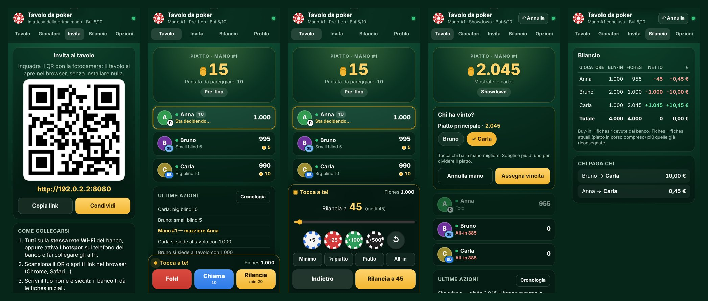
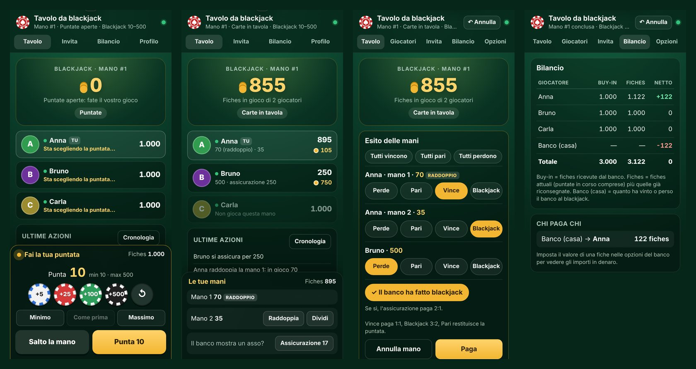

# Banco Fiches

App Android che trasforma un telefono nel **banco** di una partita a **poker** o a **blackjack**:
distribuisce le fiches, gestisce le puntate e paga le vincite. **Gli altri giocatori non installano niente**:
si collegano al telefono del banco dal browser (Chrome, Safari…) scansionando un QR code.

Le carte restano vere, sul tavolo: l'app sostituisce solo le fiches.



## Come funziona

```
 Telefono del banco (app)                Telefoni dei giocatori (solo browser)
┌──────────────────────────┐   Wi-Fi /   ┌──────────────────────────┐
│ Server web sulla 8080    │◄──hotspot──►│ http://192.168.x.y:8080  │
│ + schermata del banco    │             │ Fold · Chiama · Rilancia │
└──────────────────────────┘             └──────────────────────────┘
```

1. Il banco apre l'app: parte un piccolo server web sul telefono (resta acceso anche a schermo spento,
   c'è una notifica fissa con il pulsante **Spegni**).
2. Gli altri si collegano alla **stessa rete Wi-Fi** del banco, oppure all'**hotspot** del telefono del banco.
3. Dalla scheda **Invita** fanno scansionare il QR (o mandano il link): si apre la pagina del tavolo,
   scrivono il nome e si siedono con lo stack iniziale.
4. Il banco preme **Nuova mano**: bui automatici, mazziere che gira, turno evidenziato. Quando tocca a te
   il telefono vibra e compaiono **Fold / Check-Chiama / Punta-Rilancia** (con le fiches da toccare per
   comporre l'importo, ½ piatto, piatto, all-in).
5. Allo showdown il banco tocca il vincitore (più vincitori = piatto diviso) e le fiches vengono assegnate.

## Blackjack

Dalle **Opzioni** del banco scegli *Blackjack* (si cambia tra una mano e l'altra). Qui ognuno gioca **contro il banco**:

1. Il banco preme **Nuova mano**: si aprono le puntate e i telefoni dei giocatori vibrano.
2. Ognuno compone la puntata toccando le fiches (minimo/massimo dalle opzioni, “Come prima” ripete l'ultima)
   e conferma; può cambiarla finché il banco non chiude. Chi non punta salta la mano.
3. Il banco preme **Chiudi e distribuisci** e si giocano le carte vere. Dalla barra in basso ogni giocatore può
   **raddoppiare**, **dividere** (fino a 4 mani), prendere l'**assicurazione** (metà puntata) o **arrendersi**
   (riavrà metà puntata).
4. Il banco segna l'esito di ogni mano — **Perde**, **Pari**, **Vince** (1:1), **Blackjack** (3:2) — con le
   scorciatoie “Tutti vincono / pari / perdono”, indica se ha fatto blackjack (l'assicurazione paga 2:1) e preme **Paga**.

Nel **Bilancio** compare la riga **Banco (casa)** con quanto ha vinto o perso il banco, e “chi paga chi” la include.
Per chi non ha il telefono il banco può puntare e raddoppiare per lui dalla sua scheda.



## Funzioni

- **Due giochi**: poker (piatto comune) e blackjack (contro il banco).
- **Regole delle puntate stile Texas Hold'em**: small/big blind e ante, ordine di parola corretto anche testa a testa,
  rilancio minimo, all-in, rilanci incompleti che non riaprono le puntate, restituzione delle puntate non chiamate,
  **piatti laterali** calcolati in automatico.
- **Banco**: ricarica (rebuy), ritiro fiches, correzione stack, cambio posti, scelta del mazziere, pausa,
  rimozione, **annulla ultima operazione**, annulla mano, raddoppio bui, tavolo chiuso a nuovi ingressi.
- **Giocatori senza telefono**: il banco li aggiunge e usa “Agisci per…” quando tocca a loro.
- **Il banco può giocare** dallo stesso telefono (“Siediti al tavolo”).
- **Rientro**: se un giocatore chiude il browser rientra da solo; se cambia telefono il banco gli mostra un QR personale.
- **Bilancio** con buy-in, netto in fiches e in euro (imposta il valore di una fiche) e “chi paga chi”.
- **Partita salvata** sul telefono del banco: se l'app viene chiusa, alla riapertura riprende da dove era.
- Funziona **offline**: non serve internet, solo la rete locale.

## Installazione

1. Sul telefono Android del banco scarica [`apk/BancoFiches.apk`](apk/BancoFiches.apk)
   (da GitHub: apri il file e tocca *Download raw file*).
2. Aprilo e consenti l'installazione da “origini sconosciute” quando Android lo chiede.
3. Avvia **Banco Fiches** e consenti le notifiche (servono per tenere acceso il server in background).

Richiede Android 8.0 o superiore. I giocatori possono usare qualsiasi telefono (anche iPhone) con un browser.

## Consigli per la rete

- Il modo più affidabile è l'**hotspot del telefono del banco**: gli altri si collegano lì e aprono il link.
  Non consuma dati: il traffico resta tra i telefoni.
- Le reti Wi-Fi “ospiti” di alcuni router isolano i dispositivi tra loro: in quel caso usa l'hotspot.
- Se un ospite non riesce ad aprire il link, fagli disattivare i dati mobili (alcuni telefoni li preferiscono
  a un Wi-Fi senza internet).
- Il link è `http://` (non `https://`): è normale, la connessione resta nella rete locale.
- Se la batteria del telefono del banco è in modalità risparmio aggressivo (alcuni Xiaomi/Huawei/Samsung),
  escludi Banco Fiches dall'ottimizzazione della batteria.

## Compilare dal codice

**Con Android Studio**: apri la cartella `BancoFiches` e premi *Run* (oppure `./gradlew assembleRelease`).
Il progetto non usa librerie AndroidX: l'unica dipendenza è [NanoHTTPD](https://github.com/NanoHttpd/nanohttpd).

**Senza Android Studio** (solo strumenti da riga di comando, es. su Ubuntu
`sudo apt install aapt zipalign apksigner dalvik-exchange`):

```bash
ANDROID_JAR=/percorso/android-34/android.jar \
NANOHTTPD_JAR=/percorso/nanohttpd-2.3.1.jar \
./build-apk.sh        # → apk/BancoFiches.apk
```

L'APK è firmato con `app/bancofiches.keystore`, una chiave **non segreta** inclusa nel repository così
ogni nuova versione si installa sopra la precedente senza perdere la partita. Per pubblicare sul Play Store
crea una tua chiave privata.

**Provare sul PC senza telefono**: il server è Java puro e gira anche sul computer.

```bash
# dopo aver compilato app/src/main/java/it/bancofiches/core e i test con nanohttpd nel classpath
java -cp <classi>:nanohttpd-2.3.1.jar it.bancofiches.core.DevServer 8080 app/src/main/assets/web banco
# banco:     http://localhost:8080/#a=banco
# giocatori: http://<ip-del-pc>:8080/
```

Test del motore di gioco: `./gradlew test` (o JUnit 4 su `GameTest`).

## Struttura

| Percorso | Contenuto |
|---|---|
| `app/src/main/java/it/bancofiches/core/Game.java` | Motore: fiches, mani, giri di puntata, piatti laterali, blackjack, annulla, salvataggio |
| `app/src/main/java/it/bancofiches/core/FicheServer.java` | Server HTTP (NanoHTTPD): pagina web + API JSON con aggiornamenti in *long polling* |
| `app/src/main/java/it/bancofiches/ServerService.java` | Servizio Android in primo piano che tiene acceso il server |
| `app/src/main/java/it/bancofiches/MainActivity.java` | Schermata del banco (WebView sulla stessa pagina dei giocatori, con i comandi del banco) |
| `app/src/main/assets/web/` | Interfaccia web (HTML/CSS/JS senza framework) servita ai browser |
| `app/src/test/java/…/GameTest.java` | Test delle regole (bui, ordine di parola, rilanci, side pot, blackjack, annulla…) |
| `build-apk.sh` | Build dell'APK senza Gradle |

## API (per curiosi)

Tutte le chiamate sono `POST` form-urlencoded su `/api/<azione>`; `t` è il token del giocatore, `a` quello del banco.

- `GET /api/state?since=<versione>` — stato del tavolo; resta in attesa finché qualcosa cambia (max 25 s)
- Giocatori: `join` (name), `act` (action = fold/check/call/raise/allin, amount = totale a cui portare la puntata),
  `sitout` (value), `rename` (name), `leave`
- Giocatori al blackjack: `bjbet` (amount, 0 = ritira), `bjdouble` / `bjsplit` / `bjsurrender` (hand = indice della mano), `bjinsure`
- Banco: `start`, `award` (w = `"1,3;2"` vincitori per ogni piatto), `cancel`, `undo`, `add`, `rebuy`, `cashout`,
  `setstack`, `move`, `dealer`, `settings` (anche `game` = poker/blackjack, `bjMin`, `bjMax`), `reset`, `link`
- Banco al blackjack: `bjdeal` (chiude le puntate), `bjsettle` (o = `"3=W,L;5=B"` esiti L/P/W/B/S per mano, dbj = 1 se il banco ha blackjack)
